# @voxel/engine (voxel-engine.js)

[🇧🇷 Português](README.md) · [🇺🇸 English](README.en.md) · [Web Documentation](docs/index.html?lang=en)

High-performance 3D voxel engine for web browsers built in **TypeScript** and **Three.js**, structured on a strict concurrency architecture with **Web Workers** and total decoupling between the engine core and the application layer.

The engine provides two interchangeable rendering paradigms (**Polygonal Greedy Meshing** and **GPU Volumetric Raymarching via 3D DDA**), fluid simulation via **3D Cellular Automata**, volumetric flood-fill light propagation, and high-precision kinematic physics.

**Online demo:** https://voxel-engine-js.vercel.app/  
**Official Technical Documentation:** [Access /docs/](docs/index.html?lang=en) or navigate to `http://localhost:5173/docs/?lang=en` in dev server.

---

## Engine Highlights

- **Multi-Paradigm Rendering**:
  - **Adaptive Greedy Meshing**: Coplannar face merging and internal occlusion culling in 2D slices with *Smooth Lighting* and per-vertex *Ambient Occlusion* (AO), reducing geometry sent to the GPU by over 80%.
  - **GPU Volumetric Raymarching (3D DDA in 3D Texture)**: Direct volumetric rendering in fragment shaders without polygon mesh synthesis, with hierarchical spatial acceleration (*Two-Level DDA / BrickMap*), ideal for micro-voxels and continuous sub-block destruction.
- **Asynchronous Multi-Threaded Concurrency (Zero Frame-Drops)**:
  - Strict separation into three threads: **Main Thread** (DOM, input, and viewport), **Engine Worker** (physics, entities, lifecycle, and Three.js scene graph), and **Chunk Worker** (procedural 3D noise generation and mesh synthesis).
  - Heavy geometry and volumetric data transfer without memory copy overhead via `Transferable Objects` (`ArrayBuffer`).
- **3D Cellular Automata Fluid Simulator (`FluidCellularAutomata`)**:
  - Physical simulation on a discrete 3D lattice: terminal gravity, slope/ledge cascading, and lateral hydrostatic pressure equalization.
  - Real-time thermochemical reactions (e.g., water + lava contact solidifying into basalt with steam particle bursts).
  - Resting state optimization (*Sleeping Cells*): flat water bodies (lakes, aquifers, and oceans) enter absolute rest, consuming 0 CPU cycles until disturbed.
  - Support for continuous springs (`WaterSpring`) to perpetually feed dynamic waterfalls.
- **Volumetric 3D Lighting (Dual-Channel Flood Fill)**:
  - Independent **Sky Light** (vertically attenuated sunlight) and **Block Light** (emitted light sources) channels with levels from 0 to 15.
  - 3D propagation via BFS queues with asynchronous stitching across adjacent chunk boundaries.
  - Incremental updates: when placing or breaking light/opaque blocks, only affected nodes are recalculated.
- **Precision Kinematic Physics (Minecraft 1.8 Faithful)**:
  - Discrete 20 ticks/s physics loop decoupled from rendering framerate (camera interpolates smoothly at 60/144+ Hz).
  - Continuous AABB axis-by-axis collision resolution, configurable block slipperiness, continuous sprint-jumping, and ledge anti-fall lock (*sneak lock*).
- **Parametric Resolution Scale (`voxelsPerBlock`)**:
  - Adjustable resolution per world: from classic 1m³ blocks (1 voxel/block) to high-fidelity micro-voxels (e.g., 16 subvoxels/block, ~6.25 cm per voxel).
- **Extensible Modular Architecture**:
  - Universal registry system: blocks, items, dimensions, particles, and procedural generators.
  - Plugin API with lifecycle hooks (`setup`, `fixedUpdate`, `chunk:ready`).
  - Real-time command terminal (`CommandRegistry`).

---

## Module Architecture

The repository enforces a strict architectural boundary validated in CI (`npm run check:boundary`). The core in `engine/` is completely independent and agnostic of any specific game or example contained in `examples/`.

```
engine/                     @voxel/engine (Engine package)
  ├── index.ts              Main Thread entry point (VoxelEngine)
  ├── worker.ts             Engine Worker entry point (@voxel/engine/worker)
  ├── chunk-worker.ts       Chunk Worker entry point (@voxel/engine/chunk-worker)
  ├── core/                 Viewport, canvas, event orchestration, and worker bridges
  ├── world/                ProceduralWorld, generators, loaded chunks, and boundary stitching
  ├── chunk/                Chunk, ChunkManager, ChunkGeometry (Greedy/Naive Meshing)
  ├── render/               VoxelRaymarch, material pipeline, GLSL shaders, and uniforms
  ├── physics/              AABB, precision raycasts, FluidCellularAutomata, and collision
  ├── player/               PlayerPhysics (20Hz kinematics), controls, and camera
  ├── blocks/               BlockRegistry (metadata, opacity, luminance, and fluids)
  ├── runtime/              EngineRuntime, ChunkRuntime, and CommandRegistry
  ├── dimension/            DimensionManager, gravity parameters, and atmosphere
  ├── effects/              VoxelParticles and emitter management
  └── types.ts              Contracts, initialization options, and TypeScript interfaces

examples/                   Example applications built on top of the engine
  ├── tiny-voxels/          Micro-voxels (16 vx/block), GPU 3D DDA raymarching, and waterfalls
  └── game/                 Complete voxel game with multi-dimension travel and WS multiplayer
```

### Multi-Threaded Execution Pipeline

```mermaid
flowchart LR
    %% Subgraph 1: Main Thread
    subgraph MT ["🖥️ Main Thread · 60/144+ FPS"]
        direction TB
        VE["<b>VoxelEngine</b><br/><small>Viewport Orchestrator</small>"]
        Canvas["<b>WebGL Canvas</b><br/><small>Three.js Rendering</small>"]
        Input["<b>Input Controller</b><br/><small>Pointer Lock · Keyboard · Mouse</small>"]
        HUD["<b>DOM / Overlay</b><br/><small>HUD · Chat · Menus</small>"]

        Input --> VE
        VE --> Canvas
        VE --> HUD
    end

    %% Subgraph 2: Engine Worker
    subgraph EW ["⚙️ Engine Worker · Fixed 20 Hz"]
        direction TB
        ER["<b>EngineRuntime</b><br/><small>Simulation Loop</small>"]
        PW["<b>ProceduralWorld</b><br/><small>Active Chunks & Streaming</small>"]
        PP["<b>PlayerPhysics</b><br/><small>Kinematics & AABB Sneak</small>"]
        FCA["<b>FluidCellularAutomata</b><br/><small>3D Fluids & Reactions</small>"]
        Plugins["<b>Plugin System</b><br/><small>EngineContext & Commands</small>"]

        ER --> PW
        ER --> PP
        ER --> FCA
        ER --> Plugins
    end

    %% Subgraph 3: Chunk Worker
    subgraph CW ["🧱 Chunk Worker · Background Task"]
        direction TB
        CR["<b>ChunkRuntime</b><br/><small>Task Manager</small>"]
        WG["<b>WorldGenerator</b><br/><small>3D Simplex Noise & Biomes</small>"]
        Light["<b>Light Engine</b><br/><small>3D Flood Fill (0-15)</small>"]
        Mesher["<b>ChunkGeometry</b><br/><small>Greedy Mesher / 3D DDA</small>"]

        CR --> WG
        WG --> Light
        Light --> Mesher
    end

    %% Inter-thread connections
    VE <== "<b>postMessage</b><br/><i>Inputs, Camera & Raycast</i>" ==> ER
    ER <== "<b>Zero-Copy Transferable</b><br/><i>Float32Array Buffers</i>" ==> CR
    ER -. "<b>GPU Upload</b><br/><i>Meshes & 3D Textures</i>" .-> Canvas

    %% Modern styling
    classDef mainThread fill:#0f172a,stroke:#38bdf8,stroke-width:2px,color:#f8fafc;
    classDef engineWorker fill:#1e1b4b,stroke:#a855f7,stroke-width:2px,color:#f8fafc;
    classDef chunkWorker fill:#064e3b,stroke:#34d399,stroke-width:2px,color:#f8fafc;

    class VE,Canvas,Input,HUD mainThread;
    class ER,PW,PP,FCA,Plugins engineWorker;
    class CR,WG,Light,Mesher chunkWorker;
```



---

## How to Use the Engine

### 1. Initializing on the Main Thread

In your main entry script:

```ts
import { VoxelEngine } from '@voxel/engine';

const engine = new VoxelEngine({
  canvas: document.getElementById('renderCanvas') as HTMLCanvasElement,
  createWorker: () => new Worker(
    new URL('./workers/engine.worker.ts', import.meta.url),
    { type: 'module' }
  )
});

await engine.init();
```

### 2. Configuring the Engine Worker

In `engine.worker.ts`:

```ts
import { runEngineWorker, type EngineContext, type EnginePlugin } from '@voxel/engine/worker';

const myPlugin: EnginePlugin = {
  name: 'my-plugin',
  setup(ctx: EngineContext) {
    ctx.commands.register(['/ping'], () => {
      ctx.emitToMain('chat:message', { text: 'pong!' });
    });

    ctx.on('fixedUpdate', ({ deltaMs }) => {
      // Runs every fixed physics tick (20 Hz)
    });
  }
};

runEngineWorker({
  createChunkWorker: () => new Worker(
    new URL('./chunk.worker.ts', import.meta.url),
    { type: 'module' }
  ),
  plugins: [myPlugin],
  world: {
    chunkSize: 32,
    voxelsPerBlock: 1, // 1 = standard block, 16 = micro-voxels
    fluidSimulation: 'cellular_automata'
  }
});
```

### 3. Registering Blocks and World Generator in the Chunk Worker

In `chunk.worker.ts`:

```ts
import {
  runChunkWorker,
  blockRegistry,
  worldGeneratorRegistry,
  type ChunkContext,
  type WorldGenerator
} from '@voxel/engine/chunk-worker';

blockRegistry.register({
  id: 1,
  name: 'Stone',
  color: 0x7A7D84,
  solid: true,
  opaque: true
});

blockRegistry.register({
  id: 2,
  name: 'Crystal Water',
  color: 0x3388CC,
  solid: false,
  fluid: true,
  transparent: true,
  lightOpacity: 2
});

class MyGenerator implements WorldGenerator {
  public readonly id = 'my_generator';

  generate(ctx: ChunkContext): void {
    const { startX, endX, startY, endY, startZ, endZ } = ctx;
    for (let x = startX; x < endX; x++) {
      for (let z = startZ; z < endZ; z++) {
        const height = Math.floor(ctx.simplex.noise(x * 0.02, z * 0.02) * 10) + 16;
        for (let y = startY; y < endY; y++) {
          if (y <= height) {
            ctx.setBlock(x, y, z, 1);
          } else if (y <= 14) {
            ctx.setBlock(x, y, z, 2);
          }
        }
      }
    }
  }
}

worldGeneratorRegistry.register(new MyGenerator());
runChunkWorker();
```

---

## Core Engine Modules

### 1. `FluidCellularAutomata` (Particle Fluid Simulation)
Location: `engine/physics/FluidCellularAutomata.ts`

3D Cellular Automata simulator based on physical mass conservation:
- **Gravity Flow**: Fluids drain downward into contiguous passable space.
- **Slope Cascade**: Diagonal fall when cascading down steps, slopes, and cliffs.
- **Hydrostatic Equalization**: Lateral expansion driven exclusively by fluid column pressure.
- **Sleep State Optimization**: Stable cells go dormant; large resting water bodies cost 0 CPU.
- **Dynamic Thermochemistry**: Instant exothermic reaction between aqueous and magmatic materials (basalt formation with steam particles).
- **Perennial Springs (`WaterSpring`)**: Stable periodic emission in open sources, feeding live waterfalls without overflowing.

### 2. `VoxelRaymarch` (GPU Volumetric Rendering)
Location: `engine/render/VoxelRaymarch.ts`

Fragment shader raymarching pipeline for high-resolution voxel representations:
- Renders 3D texture volumes (`Data3DTexture`) without generating polygon vertices on CPU.
- **Hierarchical DDA (BrickMap)**: Skips empty air bounding boxes (*empty space skipping*), speeding up ray traversal up to 6x in open terrain.
- Ideal for destructible micro-voxel sculpting where triangle quad counts would bottleneck traditional pipelines.

### 3. `ChunkGeometry` (Greedy Meshing & Geometry Optimization)
Location: `engine/chunk/ChunkGeometry.ts`

Polygon mesh synthesis for classical GPU rendering:
- 2D occlusion culling discarding interior hidden faces between solid blocks.
- Merges contiguous coplanar rectangles sharing material and lighting values.
- Simultaneous generation of normals, vertex colors, UV coordinates, and Ambient Occlusion attributes.

### 4. `PlayerPhysics` (Kinematics & Avatar Control)
Location: `engine/player/PlayerPhysics.ts`

Precision kinematic engine:
- Continuous AABB collision resolution on 0.6 × 1.8 block boxes.
- Surface friction differentiation (ground, ice, fluids, slime).
- Sneak edge lock, safely preventing falls from heights.

---

## Included Examples

1. **`examples/tiny-voxels` (Micro-voxels & 3D DDA Raymarching)**:
   - Fine resolution of 16 micro-voxels per block (6.25 cm scale).
   - Switchable GPU Volumetric Raymarching and Greedy Meshing.
   - Dynamic cellular automata fluids with natural cascading waterfalls.
   - 5 procedural biomes (*Alpine Peaks*, *Cherry Blossom Shrine*, *Terracotta Canyons*, *Autumn Grove*, and *River Valleys*).
   - Continuous spherical sculpting tools with adjustable drill radiuses.

2. **`examples/game` (Complete Voxel Game & Multiplayer)**:
   - Classic 1m³ block resolution.
   - Multi-dimensional system (*Overworld*, *Nether*, *Lunar*, *Volcanic*, *Cavern*).
   - Dynamic day/night cycle and atmospheric weather (rain, snow, lightning storms, physical tornadoes).
   - Real-time multiplayer synchronization and block modifications via WebSocket.

---

## Local Development

### Prerequisites
- **Node.js** (v18 or higher)
- **npm** (bundled with Node)

### Commands

```bash
# Install dependencies
npm install

# Start local dev server (Vite)
npm run dev

# Complete quality verification (TypeScript + Engine Boundary + Shared Chunks)
npm run check

# Build for production
npm run build

# Preview production build
npm run preview
```

### Quality Scripts

- `npm run check:boundary`: Ensures `engine/` never imports anything from `examples/` or external demo code.
- `npm run check:shared`: Enforces Copy-on-Write policy across shared binary chunk buffers.

---

## License

Distributed under the MIT License. See `LICENSE` for details.
