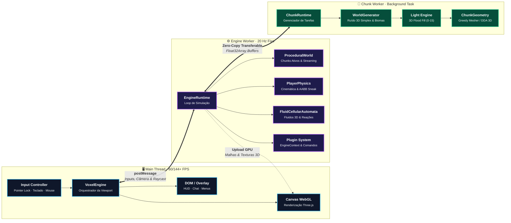

# @voxel/engine (voxel-engine.js)

[🇧🇷 Português](README.md) · [🇺🇸 English](README.en.md) · [Documentação Web / Web Docs](docs/index.html)

Motor voxel 3D de alta performance para navegadores web desenvolvido em **TypeScript** e **Three.js**, estruturado sobre uma arquitetura estrita de concorrência com **Web Workers** e desacoplamento total entre o núcleo da engine e a camada de aplicação.

O motor oferece dois paradigmas de renderização intercambiáveis (**Polygonal Greedy Meshing** e **GPU Volumetric Raymarching via DDA 3D**), simulação de fluidos por **Autômato Celular 3D**, propagação volumétrica de luz por flood fill e física cinemática de alta precisão.

**Demo online:** https://voxel-engine-js.vercel.app/  
**Documentação Técnica da Engine:** [Acessar /docs/](docs/index.html) ou navegue para `http://localhost:5173/docs/` no dev server.

---

## Destaques da Engine

- **Renderização Multi-Paradigma**:
  - **Greedy Meshing Adaptativo**: Mesclagem de faces coplanares e descarte de oclusão interna em fatias 2D com *Smooth Lighting* e *Ambient Occlusion* (AO) por vértice, reduzindo em mais de 80% a geometria enviada à GPU.
  - **GPU Volumetric Raymarching (DDA em Textura 3D)**: Renderização direta de dados volumétricos em fragment shader sem geração de malha poligonal, com aceleração espacial hierárquica (*Two-Level DDA / BrickMap*), ideal para minivoxels e destruição sub-bloco contínua.
- **Concorrência Assíncrona Multi-Threaded (Zero Frame-Drops)**:
  - Separação estrita em três threads: **Main Thread** (DOM, input e viewport), **Engine Worker** (física, entidades, ciclo de vida e grafo Three.js) e **Chunk Worker** (geração procedural de ruídos 3D e síntese de malhas).
  - Transferência de dados pesados de geometria e volumetria sem custo de cópia de memória via `Transferable Objects` (`ArrayBuffer`).
- **Simulador de Fluidos por Autômato Celular 3D (`FluidCellularAutomata`)**:
  - Simulação física em reticulado tridimensional discreto: gravidade terminal, escorrimento em encostas/degraus e espalhamento lateral por pressão hidrostática de coluna.
  - Reações termoquímicas em tempo real (ex.: contato água + lava solidificando em basalto com partículas de vapor).
  - Otimização com estado de repouso (*Sleeping Cells*): corpos d'água planos (lagos, aquíferos e oceanos) entram em repouso absoluto, consumindo 0 ciclos de CPU até serem perturbados.
  - Suporte a nascentes contínuas (`WaterSpring`) para alimentação perpétua de cachoeiras dinâmicas.
- **Iluminação Volumétrica 3D (Dual-Channel Flood Fill)**:
  - Canais independentes de **Sky Light** (luz solar atenuada verticalmente) e **Block Light** (fontes de luz emitidas) em níveis de 0 a 15.
  - Propagação tridimensional em fila BFS com costura assíncrona entre bordas de chunks contíguos.
  - Atualização incremental pontual: ao quebrar ou inserir blocos emissores/opacos, apenas os nós afetados são recalculados.
- **Física Cinemática de Precisão (Minecraft 1.8 Faithful)**:
  - Loop físico discreto a 20 ticks/s desacoplado da taxa de quadros de renderização (câmera com interpolação suave a 60/144+ Hz).
  - Colisão contínua com resolução AABB por eixo, atrito configurável por bloco (*slipperiness*), sprint-jump contínuo e trava anti-queda em quinas ao agachar (*sneak lock*).
- **Escala de Resolução Paramétrica (`voxelsPerBlock`)**:
  - Resolução ajustável por mundo: de blocos volumosos tradicionais (1 voxel/bloco) até minivoxels de altíssima fidelidade (ex.: 16 subvoxels/bloco, ~6.25 cm por voxel).
- **Arquitetura Modular Extensível**:
  - Sistema universal de registros: blocos, itens, dimensões, partículas e geradores procedurais.
  - API de plugins com ganchos de ciclo de vida (`setup`, `fixedUpdate`, `chunk:ready`).
  - Terminal de comandos em tempo real (`CommandRegistry`).

---

## Arquitetura de Módulos

O repositório impõe uma barreira arquitetural estrita verificada em CI (`npm run check:boundary`). O núcleo em `engine/` é totalmente independente e agnóstico a qualquer jogo ou demonstração específica contida em `examples/`.

```
engine/                     @voxel/engine (Pacote do motor)
  ├── index.ts              Ponto de entrada na Main Thread (VoxelEngine)
  ├── worker.ts             Ponto de entrada do Engine Worker (@voxel/engine/worker)
  ├── chunk-worker.ts       Ponto de entrada do Chunk Worker (@voxel/engine/chunk-worker)
  ├── core/                 Orquestração de viewport, canvas, eventos e bridge de workers
  ├── world/                ProceduralWorld, geradores, chunks carregados e costura de bordas
  ├── chunk/                Chunk, ChunkManager, ChunkGeometry (Greedy/Naive Meshing)
  ├── render/               VoxelRaymarch, pipeline de materiais, shaders GLSL e uniforms
  ├── physics/              AABB, raycast de precisão, FluidCellularAutomata e colisão
  ├── player/               PlayerPhysics (cinemática 20Hz), controles e câmera
  ├── blocks/               BlockRegistry (metadados, opacidade, luminosidade e fluidos)
  ├── runtime/              EngineRuntime, ChunkRuntime e CommandRegistry
  ├── dimension/            DimensionManager, parâmetros gravitacionais e atmosfera
  ├── effects/              VoxelParticles e gerenciamento de emissores
  └── types.ts              Contratos, opções de inicialização e interfaces TypeScript

examples/                   Aplicações de exemplo construídas sobre a engine
  ├── tiny-voxels/          Micro-voxels (16 vx/bloco), raymarch DDA em GPU e cachoeiras vivas
  └── game/                 Jogo voxel completo com múltiplas dimensões e multiplayer via WS
```

### Pipeline de Execução Multi-Threaded



---

## Como Utilizar a Engine

### 1. Inicializando na Main Thread

No script da página principal:

```ts
import { VoxelEngine } from '@voxel/engine';

const engine = new VoxelEngine({
  canvas: document.getElementById('renderCanvas') as HTMLCanvasElement,
  // Fábrica para criar o worker que executa o loop da engine:
  createWorker: () => new Worker(
    new URL('./workers/engine.worker.ts', import.meta.url),
    { type: 'module' }
  )
});

await engine.init();
```

### 2. Configurando o Engine Worker

No arquivo `engine.worker.ts`:

```ts
import { runEngineWorker, type EngineContext, type EnginePlugin } from '@voxel/engine/worker';

// Plugin customizado para lógica do seu projeto
const meuPlugin: EnginePlugin = {
  name: 'meu-plugin',
  setup(ctx: EngineContext) {
    ctx.commands.register(['/ping'], () => {
      ctx.emitToMain('chat:message', { text: 'pong!' });
    });

    ctx.on('fixedUpdate', ({ deltaMs }) => {
      // Executado a cada tick físico fixo (20 Hz)
    });
  }
};

runEngineWorker({
  // Fábrica para instanciar workers de processamento pesado de chunks
  createChunkWorker: () => new Worker(
    new URL('./chunk.worker.ts', import.meta.url),
    { type: 'module' }
  ),
  plugins: [meuPlugin],
  world: {
    chunkSize: 32,
    voxelsPerBlock: 1, // 1 = voxel padrão, 16 = minivoxels
    fluidSimulation: 'cellular_automata'
  }
});
```

### 3. Registrando Blocos e Gerador no Chunk Worker

No arquivo `chunk.worker.ts`:

```ts
import {
  runChunkWorker,
  blockRegistry,
  worldGeneratorRegistry,
  type ChunkContext,
  type WorldGenerator
} from '@voxel/engine/chunk-worker';

// Registra tipos de blocos
blockRegistry.register({
  id: 1,
  name: 'Pedra',
  color: 0x7A7D84,
  solid: true,
  opaque: true
});

blockRegistry.register({
  id: 2,
  name: 'Água Cristalina',
  color: 0x3388CC,
  solid: false,
  fluid: true,
  transparent: true,
  lightOpacity: 2
});

// Registra um gerador de mundo procedural
class MeuGerador implements WorldGenerator {
  public readonly id = 'meu_gerador';

  generate(ctx: ChunkContext): void {
    const { startX, endX, startY, endY, startZ, endZ } = ctx;
    for (let x = startX; x < endX; x++) {
      for (let z = startZ; z < endZ; z++) {
        const height = Math.floor(ctx.simplex.noise(x * 0.02, z * 0.02) * 10) + 16;
        for (let y = startY; y < endY; y++) {
          if (y <= height) {
            ctx.setBlock(x, y, z, 1);
          } else if (y <= 14) {
            ctx.setBlock(x, y, z, 2);
          }
        }
      }
    }
  }
}

worldGeneratorRegistry.register(new MeuGerador());
runChunkWorker();
```

---

## Módulos Centrais da Engine

### 1. `FluidCellularAutomata` (Simulação de Fluidos em Partículas)
Localização: `engine/physics/FluidCellularAutomata.ts`

Simulador tridimensional por autômato celular baseado em conservação física:
- **Fluxo por Gravidade**: Fluido desloca-se verticalmente para baixo no espaço contíguo passável.
- **Cascata em Encostas**: Queda diagonal ao deslizar por rampas, bordas e desfiladeiros.
- **Espalhamento Hidrostático**: Nivelamento horizontal acionado exclusivamente sob pressão de coluna de voxels superiores ou bordas de penhasco (*ledges*).
- **Repouso Otimizado (*Sleep State*)**: Células estáveis são removidas do conjunto ativo; grandes corpos d'água estáticos possuem custo zero de processamento.
- **Termoquímica Dinâmica**: Reação exotérmica instantânea entre materiais aquosos e magmáticos (geração de Basalto com ejeção de partículas de vapor).
- **Nascentes Naturais (`WaterSpring`)**: Emissão periódica contínua em fontes abertas, sustentando cascatas e cachoeiras vivas sem risco de transbordamento.

### 2. `VoxelRaymarch` (Renderização Volumétrica em GPU)
Localização: `engine/render/VoxelRaymarch.ts`

Pipeline de raymarching em fragment shader para representação de voxels em alta resolução:
- Renderiza volumes armazenados em texturas 3D (`Data3DTexture`) sem gerar vértices na CPU.
- **Hierarchical DDA (BrickMap)**: Pula caixas delimitadoras de blocos vazios (*empty space skipping*), reduzindo passos de amostragem por raio em até 6x em terrenos abertos.
- Ideal para mundos com micro-relevo escavável onde a contagem de quads poligonais inviabilizaria o pipeline tradicional.

### 3. `ChunkGeometry` (Greedy Meshing e Otimização Geométrica)
Localização: `engine/chunk/ChunkGeometry.ts`

Síntese poligonal para renderização clássica em GPU:
- Varredura de oclusão bidimensional descartando faces cegas entre blocos sólidos.
- Fusão de retângulos coplanares contíguos de mesmo material e mesmo estado de iluminação.
- Geração simultânea de normais, cores por vértice, coordenadas UV e atributos de *Ambient Occlusion*.

### 4. `PlayerPhysics` (Cinemática e Controle de Jogador)
Localização: `engine/player/PlayerPhysics.ts`

Motor cinemático fiel aos padrões de precisão:
- Resolução de colisões AABB contínuas em caixas de 0.6 × 1.8 blocos.
- Diferenciação de atrito em superfícies terrestres, aquáticas e viscosas.
- Suporte a agachamento com trava em bordas (*sneak*), prevenindo quedas acidentais em desníveis.

---

## Exemplos Inclusos

O repositório disponibiliza implementações completas demonstrando as capacidades da engine em diferentes configurações:

1. **`examples/tiny-voxels` (Minivoxels & Raymarching DDA)**:
   - Resolução fina de 16 minivoxels por bloco (escala de 6.25 cm).
   - Renderização por GPU Raymarching volumétrico e Greedy Meshing alternáveis.
   - Autômato celular de fluidos integrado com cachoeiras naturais ativas.
   - Geração procedural volumétrica com 5 biomas ricos (*Picos Alpinos*, *Santuário de Sakura*, *Cânions de Terracota*, *Bosque de Outono* e *Vales Fluviais*).
   - Ferramentas de escultura esférica contínua com brocas de raio ajustável.

2. **`examples/game` (Jogo Voxel Completo & Multiplayer)**:
   - Resolução de bloco clássico de 1m³.
   - Sistema multi-dimensional (*Overworld*, *Nether*, *Lunar*, *Volcanic*, *Cavern*).
   - Ciclo dinâmico de dia/noite e sistema climático (chuva, neve, tempestade com raios e tornados físicos).
   - Sincronização de jogadores e modificações de blocos em tempo real via WebSocket.

---

## Desenvolvimento Local

### Pré-requisitos
- **Node.js** (v18 ou superior)
- **npm** (incluso com Node)

### Comandos

```bash
# Instalar dependências
npm install

# Iniciar servidor local de desenvolvimento (Vite)
npm run dev

# Validação completa de qualidade (TypeScript + Checagem de Fronteira de Engine + Shared Chunks)
npm run check

# Compilação para produção
npm run build

# Pré-visualização do build de produção
npm run preview
```

### Scripts de Validação

- `npm run check:boundary`: Garante que o diretório `engine/` não importe nenhum arquivo de `examples/` ou código externo ao motor.
- `npm run check:shared`: Valida a integridade da política de Copy-on-Write em buffers de chunks compartilhados.

---

## Licença

Distribuído sob licença MIT. Consulte o arquivo `LICENSE` para mais detalhes.
